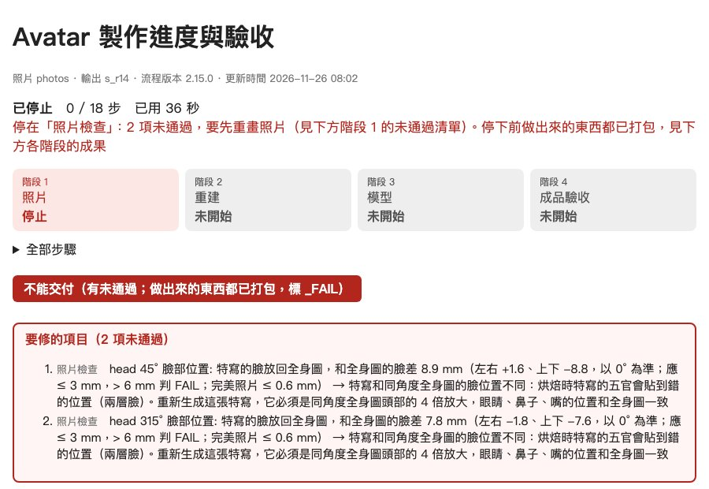
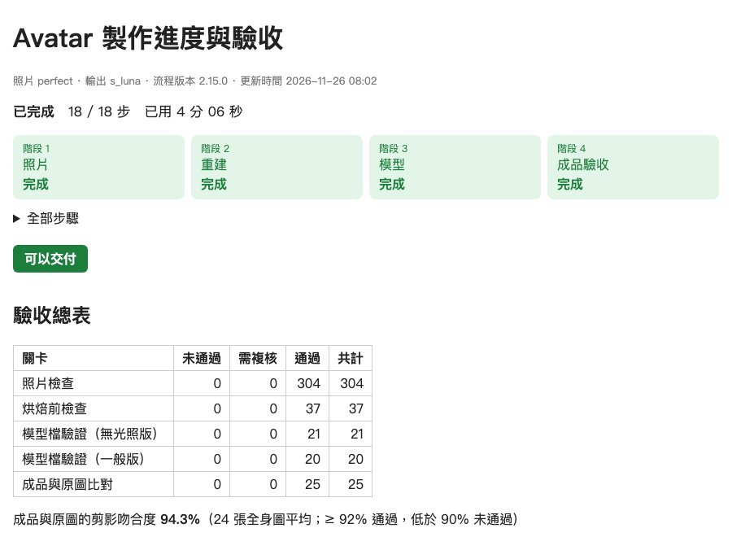

# 標準作業流程（SOP）

[返回 README](../README.md) · [流程與驗收](Workflow-and-Validation.md) · [Loop engineering 的理論基礎](Loop-Engineering-Theory.md)

**一句話：人只準備輸入與 token，其他都交給 AI：AI 生圖、修圖，AI 跑流程、讀診斷、改程式。四個階段，每個階段沒有 FAIL 才進下一個；FAIL 的當下也會交出一包結果；四包都是好的才能交付。**

## 誰做什麼

三個 agent 怎麼分工（Claude 維護 SOP 與程式；ChatGPT、Gemini 各自開發一個 avatar；處理不掉就發 GitHub issue 給 Claude）見[專案迴圈](Project-Loop.md)。

| 誰 | 做什麼 |
| --- | --- |
| **人** | 1. **準備輸入**：人物的參考圖或設定（給 AI 生圖用），以及資料 repo `WangChengYeh/avatar_data`（見[專案迴圈](Project-Loop.md#avatar-放在哪裡)）。<br>2. **提供 token**：AI 生圖、AI 寫程式所需的 API key 與額度；GitHub token（`gh auth login`）要能在 `WangChengYeh/Avatar` 開 issue／PR、在 `WangChengYeh/avatar_data` 建 Release。<br>其他都不用動手：不改圖、不改程式、不手動修中間檔。 |
| **AI 生圖** | 依[生圖規格](Workflow-and-Validation.md#生圖規格)生 33 張照片；收到 **AI 修圖單**（`ai_fix_request/`）就照單重畫那幾張。 |
| **AI 寫程式**（Claude Code、Codex 等） | 照[執行者 runbook](Agent-Runbook.md) 反覆跑 `next_step.py`（它會跑 `run_all.py`、自動上傳到資料 repo、自動抓新的 SOP）、讀客戶頁與診斷；照片有問題就把 AI 修圖單交給 AI 生圖；程式有問題就照 **AI 改 code 單**（`ai_code_request/`）補檢查、改程式、驗收、開 PR；逐項看需複核（WARN）並記在 Issue；在 Yoga2 做匯入驗收。 |

## 東西放在哪裡、怎麼交換（GitHub ＋ 雲端硬碟）

SOP、程式、問題、程式改動在 GitHub；照片與結果包在雲端硬碟的 `avatar/`（實際做法，執行者把每一版放在自己的資料夾）。不用 email 或手動傳檔。找檔案先看[重要檔案清單](File-List.md)。

| 東西 | 放在哪裡 | 誰放、什麼時候 | 誰拿、怎麼拿 |
| --- | --- | --- | --- |
| SOP、程式、檢查 | [`WangChengYeh/Avatar`](https://github.com/WangChengYeh/Avatar) 的 main | Claude 合併 PR | 執行者：`next_step.py` 每次自動 `git fetch`，main 有新的就叫你 `git pull`、重跑（UPDATE） |
| 照片、結果包 | 雲端硬碟 `avatar/<chatgpt|gemini>/<avatar_NNN>/vNNN/`（一個版本一個資料夾） | 執行者每個版本跑完放上去 | 所有人（Claude、ChatGPT、Gemini）都用 Google Drive 連結器讀寫，依資料夾或檔名找 |
| 同上（備用） | [`WangChengYeh/avatar_data`](https://github.com/WangChengYeh/avatar_data) 的 **Release** | 執行者的 `next_step.py` 有 gh 時**自動上傳** | 任何人：`python body3d/data_repo.py fetch <tag> DIR` |
| 處理不掉的問題 | `WangChengYeh/Avatar` 的 **Issue**（SOP 升級表單） | 執行者（next_step 走到 ESCALATE 時，內文已寫好、附 Release 連結） | Claude：下載 Release 重現、修好開 PR `Fixes #N` |
| 程式改動 | `WangChengYeh/Avatar` 的 **PR** | 執行者（照 AI 改 code 單）或 Claude | Claude review、合併；執行者下次跑 next_step 自動更新 |

**Release 的規則**（有 gh 的執行者才會上傳；目前兩個執行者都用雲端硬碟）

- tag：`<agent>-<avatar>-v<NNN>`（例：`chatgpt-avatar_001-v003`），對應執行者機器上的 `~/avatar/<agent>/<avatar>/v<NNN>/`。
- 附件：`photos.zip`（這一版的 33 張照片）、四個階段的結果包（好或 `_FAIL`）、`gates.json`、`diagnosis.json`、`next_step.md`。說明欄是驗收總表與程式版本。
- 同一版本結果變了（例如重跑）會自動重傳、取代舊的附件；新的一輪一律是新的版本，不覆蓋舊的 Release。
- 照片與 GLB 不 commit 進 git：每輪幾十 MB，放 Release 不會讓 repo 變大（單檔上限 2 GB）。
- 不要手動改 Release 的附件；上傳失敗時 `next_step.md` 會寫原因，下次再試，一直失敗就照 ESCALATE 發 issue。
- 資料 repo 放的是人物照片：設成**私人**，只給三個 agent 的 GitHub token 存取。

**執行者機器上的工作區**

```
~/avatar/
├── chatgpt/avatar_001/
│   ├── v001/photos/  v001/output/      ← 上傳成 Release chatgpt-avatar_001-v001
│   ├── v002/ …                         ← 重畫或重跑都開下一個版本
│   └── avatar_state.json  next_step.md  issue.md
└── gemini/avatar_001/ …（每個執行者各自從 001 編號）
```

## 流程（AI 跑，人看）

1. **AI 生圖**：33 張照片放進一個新的資料夾。規格見[輸入照片](Workflow-and-Validation.md#輸入照片)與[生圖規格](Workflow-and-Validation.md#生圖規格)。
2. **AI 執行一行指令**，輸出到一個新的資料夾：

   ```sh
   python body3d/run_all.py ./photos ./output-0601 --name body
   ```

3. **打開 `output-0601/client/index.html`** 看結果（人隨時可以看；跑的時候每 20 秒自動更新）。
4. 看畫面最上面：
   - 綠色「**可以交付**」→ AI 做[可以交付了嗎](#可以交付了嗎)的檢查。
   - 紅色「**不能交付**」→ 紅框「**要修的項目**」附 AI 修圖單或 AI 改 code 單，AI 照[停下來時怎麼辦](#停下來時怎麼辦)處理，修好從頭重跑。

## 你會看到什麼

### 客戶頁（`client/index.html`）

停在照片檢查的樣子（R14 照片，2 項未通過）：



由上往下：

1. **進度**：停在哪一步、用了多久。四個方塊是四個階段：灰色未開始、黃色進行中、綠色完成、紅色停止。
2. **可以交付／不能交付**。
3. **要修的項目**（紅框）：每一個未通過項目，「→」後面是怎麼修。只要有 FAIL，這裡就會列出來，需複核（WARN）不放進來。
4. **驗收總表**：每道關卡的未通過、需複核、通過、共計。
5. **各階段**：每個階段的圖、結果包下載連結、未通過與需複核清單（未通過排在前面）。

四個階段都通過的樣子（Luna 完美照片）：



### 終端機

停下來時（最後幾行）：

```
[ 1/18] check
停在步驟 check: 照片檢查有 FAIL（見 run_all.log / turnaround_report.png）。修正照片，或加 --force 繼續做完供診斷
     階段 1 成果（有未通過，標 _FAIL）：output-0601/deliver/body_stage1_photos_FAIL.zip

驗收總表               FAIL  WARN  PASS  共計
  1 照片檢查              2    88   218   308  ← FAIL
  可交付: 否（有 FAIL）
```

全部通過時：

```
[ 1/18] check
     階段 1 成果（好，可交付）：output-0601/deliver/body_stage1_photos.zip
[ 2/18] cams
   …
[12/18] bake
     階段 2 成果（好，可交付）：output-0601/deliver/body_stage2_reconstruction.zip
   …
[17/18] verify
     階段 3 成果（好，可交付）：output-0601/deliver/body_stage3_models.zip
[18/18] fit

驗收總表               FAIL  WARN  PASS  共計
  1 照片檢查              0     0   304   304
  2 烘焙前檢查            0     0    37    37
  3 GLB 驗證（unlit）     0     0    21    21
  3 GLB 驗證（lit）       0     0    20    20
  4 最終驗收              0     0    25    25
  可交付: 是
     階段 4 成果（好，可交付）：output-0601/deliver/body_stage4_acceptance.zip
```

結束碼：跑到最後、跑過的關卡全部 0 FAIL 為 0；停下或有 FAIL 為 1。

### 結果包（`deliver/` 資料夾）

每個階段結束就多一包。檔名就是結果：

| 你看到 | 意思 |
| --- | --- |
| `body_stage1_photos.zip` | 階段 1 好的結果，可交付 |
| `body_stage1_photos_FAIL.zip` | 階段 1 不好：有 FAIL，或停在這個階段。有多少給多少，可以看、可以留存，不能交付 |

停在照片檢查時，資料夾裡只有 `body_stage1_photos_FAIL.zip`；四個階段都通過時是四包好的：

```
deliver/body_stage1_photos.zip
deliver/body_stage2_reconstruction.zip
deliver/body_stage3_models.zip
deliver/body_stage4_acceptance.zip
```

## 四個階段：每個階段你看到什麼、拿到什麼

| 階段 | 做什麼 | 客戶頁的圖 | 結果包 | 通過 | 未通過（停下） |
| --- | --- | --- | --- | --- | --- |
| 1 照片 | 檢查 33 張照片 | 33 張總覽 | `stage1_photos`：33 張原檔＋照片檢查報告 | 進階段 2 | 重畫照片 |
| 2 重建 | 第 2–11 步：相機、外形、網格、頭部對位、臉部、UV；最後烘焙前檢查 | 全身與頭部特寫的頭部對照、疊圖 | `stage2_reconstruction`：相機、人體網格、對照圖 | 進階段 3 | 多半是照片（特寫角度、五官位置），回階段 1 |
| 3 模型 | 第 12–17 步：烘焙貼圖、匯出、骨架、材質；最後驗證 GLB | 正面、3/4、側面、背面 | `stage3_models`：兩個 GLB＋預覽圖 | 進階段 4 | 程式的問題 |
| 4 成品驗收 | 第 18 步：用照片的相機拍模型，和原圖比 | 左原圖、右模型（全身 8 角度、頭部 8 角度） | `stage4_acceptance`：對照圖、數字 | 四包都好 → 交付 | 先看照片檢查第 10 / 10d / 10e 項 |

## 停下來時怎麼辦

照[診斷 SOP](Diagnosis-Tree.md#診斷-sop)處理。看客戶頁紅框「**要修的項目**」：每一項都有**診斷**（診斷樹走到的葉子）：原因所在的階段、原因、誰要修（照片／程式）、信心、怎麼修、一路問過的問題與數字，並且**已經排好修的順序：前面階段的先修，同一個階段信心高的先修**（第一項標「先修這一項」）。同樣的內容在 `OUT/diagnosis.json` 與 `_FAIL.zip` 裡的 `manifest.json`（`diagnosis`、`failures`）。然後照這四步修：

1. **釐清是哪個階段的問題；多個 FAIL 時照順序，一次修一個階段。** 問題在哪個階段出現（它被哪一關抓到）不一定是它發生的階段：例如烘焙前檢查（階段 2）抓到的五官錯位，可能是照片（階段 1）畫錯，也可能是重建（階段 2）算錯。看診斷的路徑。
2. **改那個階段的檢查，讓它抓得到這個問題（檢查要會 FAIL）。** 在那個階段加一項或改一項檢查，用出問題的那組照片驗證它會 FAIL，用兩組完美照片驗證它是 PASS。這樣問題就在它發生的階段被擋下，下次不用等到後面才發現。
3. **在那個階段裡面修。**
   - **照片（階段 1）**：照片是 AI 生的，就叫 AI 修圖。客戶頁與結果包有「**AI 修圖單**」（`ai_fix_request/AI修圖單.md`）：要修哪幾張、問題、怎麼修、量到的數字，附原圖與「應該的樣子」參考圖。把整個 `ai_fix_request/` 交給 AI 生圖，修好的照片放進新的照片資料夾。照片其實不夠好、照片檢查卻沒抓到時，先由 AI 改程式補上照片檢查（第 2 步），再叫 AI 生圖。
   - **程式（階段 2–4）**：交給 AI 改程式。客戶頁與結果包有「**AI 改 code 單**」（`ai_code_request/AI改code單.md`）：原因、數字、要補的檢查、要改的檔、驗收方式（這組照片的檢查由 FAIL 變 PASS、兩組完美照片四道關卡仍全部通過、測試通過），做完開 PR。一次只出一個階段的單：照片有問題時先出 AI 修圖單，程式的單等照片修好、重跑後再出。
4. **用新的輸出資料夾從頭再跑一次。**

**照片的錯只在照片修，程式的錯只在程式修。** 不能手動補（例如手動平移某張特寫的相機、手動改中間檔）：那樣的結果無法重現，也不能交付。

### 自動修正

照片檢查未通過時，`run_all.py` 先看能不能自動修：每一項都要是**經過證明**的修正（對照實驗裡讓後面的關卡變好，見[診斷樹](Diagnosis-Tree.md#自動修正的條件)），而且修完用同一項檢查驗證通過，才修；修正後的照片另存在 `OUT/photos_fixed_rN/`，原檔不動，記在 `autofix.json`。有任何一項不是，就停下交給 AI 重畫。目前沒有經過證明的修正，所以未通過一律停下。`--no-autofix` 關掉。

### 想先看到 GLB：`--force`

```sh
python body3d/run_all.py ./photos ./output-0601-force --name body --force
```

有 FAIL 也做完四個階段，拿得到 GLB 和每個階段的結果包，用來看問題在後面怎麼出現。但從第一個 FAIL 起全部是 `_FAIL`，**不能交付**；照片未通過時，重建用較寬的相機搜尋範圍（±10° / ±16°），結果本來就和照片修好後不同。缺少 MediaPipe、Blender 時一律先裝好，`--force` 不能跳過。

### 只想先檢查照片

```sh
python body3d/deliver.py stage1 ./photos ./output-0601
```

只做階段 1：檢查並打包照片（好 → `stage1_photos.zip`，結束碼 0；不好 → `stage1_photos_FAIL.zip`，結束碼 1）。

## 可以交付了嗎

全部打勾才交付：

- [ ] 客戶頁顯示綠色「可以交付」，`gates.json` 的 `deliverable` 為 `true`。
- [ ] `deliver/` 有四包，沒有任何 `_FAIL`；資料 repo 上這個版本的 Release 也是這四包（`next_step.md` 顯示「已上傳」）。
- [ ] 這次是從頭在新的輸出資料夾跑的：沒有 `--force`，沒有 `--from`／`--only`；照片在新的資料夾、沒有改名或覆蓋；用最新版 main。
- [ ] AI 逐項看過需複核（WARN），記在 Issue。
- [ ] AI 在 Three.js／Yoga2 匯入 GLB，比對 0°／90°／180°（有疑點加 45°／315° 與特寫），並測站姿與抬手（README 的 Loop engineering 第 1 步）。

交付內容：資料 repo 上那個版本的 **Release**（四個好的結果包都在附件裡，連結就是交付物）、`client/` 整個資料夾、Yoga2 站姿／抬手截圖。在 Issue 貼上 Release 連結、驗收總表與前後對照圖，關閉 Issue。

---

## 附錄

### 規則

1. 這個階段沒有 FAIL，才進下一個階段；有 FAIL 就停。
2. FAIL 的當下也會有一包結果：停下的階段有多少給多少（`_FAIL`），之前通過的階段各有一包好的。程式出錯停下時也一樣。
3. 例外：`--force` 做完四個階段，只供診斷，從第一個 FAIL 起全部 `_FAIL`。
4. 四包都是好的，才能交付。
5. 照片的錯只在階段 1 修，程式的錯只在該階段的程式修；不手動補。

### 每個階段的成果

| 結果包 | 內容 | 好的條件 |
| --- | --- | --- |
| `{name}_stage1_photos` | 33 張照片原檔（2048 × 2048 JPEG，檔名照規格）＋照片檢查報告 | 關卡 1 0 FAIL，33 張齊全 |
| `{name}_stage2_reconstruction` | 相機 `cams33.json`、人體網格（`body33s.ply`，MakeHuman 版 `body_mh.ply`）、頭部對照圖與回投疊圖 | 關卡 1–2 0 FAIL |
| `{name}_stage3_models` | 兩個 GLB（`{name}_rigged.glb` 無光照、`{name}_rigged_lit.glb`）＋預覽圖 | 關卡 1–3 0 FAIL |
| `{name}_stage4_acceptance` | 原圖對模型對照圖、`fit_report.json`、`gates.json` | 關卡 1–4 0 FAIL |

同一個階段同時只會有好或 `_FAIL` 其中一包（每次打包先刪掉舊的）。每包的 `manifest.json`：

| 欄位 | 內容 |
| --- | --- |
| `deliverable` | 好（`true`）或不好（`false`） |
| `gates` | 這個階段和之前每道關卡的 FAIL / WARN / PASS |
| `failures` | 每一個未通過項目的原文 |
| `missing` | 缺少的檔：缺照片，或停在這個階段時還沒做出來的檔 |
| `stopped` | 停在這個階段時：停在哪一步、原因 |
| `sha256` | 包裡每個檔的 SHA-256，用來確認拿到的是同一份 |

### 四道關卡

| 關卡 | 指令（`run_all.py` 自動執行） | 檢查什麼 |
| --- | --- | --- |
| 1 照片檢查 | `check_turnaround.py PHOTOS` | 33 張照片本身：檔名、解析度、構圖、角度、相機距離、對準點、透視、光線、耳朵、臉部比例、頭部朝向、特寫與全身的臉部位置 |
| 2 烘焙前檢查 | `check_turnaround.py PHOTOS --head-overlap-work WORK` | 重建後的相機與網格：頭部特寫相機角度、全身與特寫的五官位置、頭部重疊區亮度 |
| 3 GLB 驗證 | `verify_glb.py OUT/*.glb` | GLB 結構、骨架與蒙皮、身高、無光照材質、頭部貼圖條紋（unlit／lit 兩個檔各驗一次） |
| 4 最終驗收 | `fit_report.py WORK --accept` | 成品網格投影回 24 張全身原圖的剪影不一致：平均 ≤ 8% PASS、> 10% FAIL；單張 > 12% WARN |

每道關卡最後都印：`總結: N 個 FAIL, N 個 WARN, N 個 PASS，共 N 項`。各項門檻見[流程與驗收](Workflow-and-Validation.md)。

### PASS / WARN / FAIL

| 結果 | 客戶頁寫法 | 意思 | 處理 |
| --- | --- | --- | --- |
| PASS | 通過 | 在完美照片 + 小餘裕的門檻內 | 不用處理 |
| WARN | 需複核 | 超出完美照片的範圍，但還不會直接造成模型或貼圖缺陷 | 結果包仍是好的。交付前逐項看過、記在 Issue；同一項反覆出現或變多時，回頭修照片 |
| FAIL | 未通過 | 會直接造成重建缺陷（重影、接縫、錯位、變形），或規格錯誤 | 結果包是 `_FAIL`，一定要清掉。照片的 FAIL 只能重畫照片，不改門檻遷就照片 |

門檻只有一套：照片一律要先經 AI 修正才進來，門檻由完美合成照片（Luna `luna-v1.glb` 與舊測試模型，兩者都必須 0 FAIL／0 WARN）加小餘裕校準。要改門檻，先證明完美照片仍是 0 FAIL／0 WARN。

### 每個階段給客戶看什麼

客戶是內部客戶：每個階段都給圖和結果包，未通過與需複核照實列出，頁面全部中文。`client/index.html` 每一步開始與結束時更新（進行中每 20 秒自動重新整理），全部結束或停下時再完整產生一次（含 Blender 渲染的原圖對模型）。單獨產生：`python body3d/client_report.py PHOTOS OUT`。

| 階段 | 圖 | 客戶看什麼 |
| --- | --- | --- |
| 1 照片 | `01_photos.jpg`：33 張總覽（水平、俯角 30°、仰角 20°、頭部特寫、俯視） | 人、髮型、服裝、表情對不對 |
| 2 重建 | `02_head_review.png`、`02_head_overlap.png` | 全身照和頭部特寫的頭部是否一致 |
| 3 模型 | `03_preview.jpg`：正面、3/4、側面、背面渲染 | 整體外觀、比例、貼圖 |
| 4 成品驗收 | `04_body_compare.jpg`、`05_head_compare.jpg`：用照片的規格相機拍模型，左原圖、右模型 | 兩邊應該一樣：臉的朝向、五官、輪廓、顏色；剪影吻合度（平均 ≥ 92% 通過） |

### 已知限制

- MakeHuman 模板（`--template makehuman`）：身體、手指、骨架來自 MakeHuman，頭來自外殼（body3d 2.18 起；之前用 MakeHuman 的通用臉，0°–45° 之間有接縫，R31）。兩組完美照片四道關卡 0 FAIL；四道關卡都 0 FAIL 時可交付。預設仍是外殼流程。
- 檢查還沒涵蓋網格自我穿插；Yoga2 看到斑點或摺痕時，先用 Blender 實際渲染確認（`verify_glb --renders` 的頭部圖用點去畫，會冒出假的小點）。
- Yoga2 的站姿、抬手截圖還沒自動化：由 AI 用瀏覽器開 Yoga2 匯入 GLB 後截圖。
